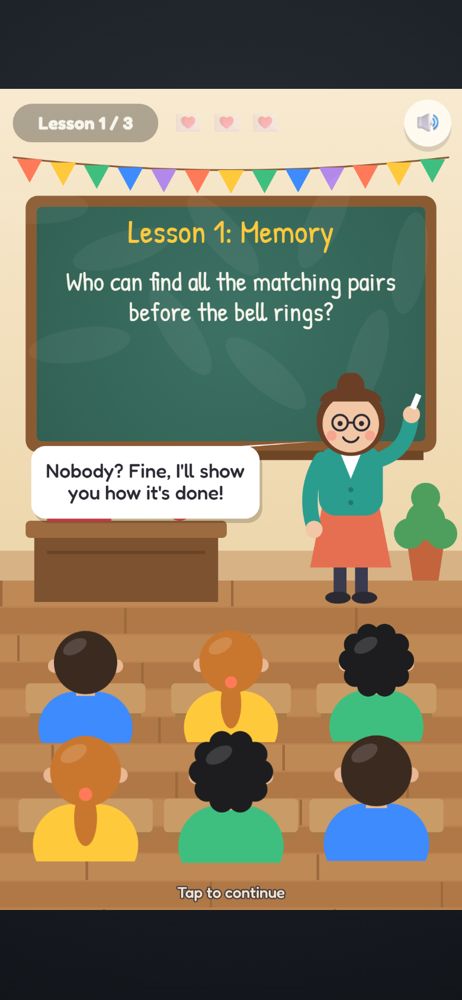

# Ders Başlıyor! (Class Is In Session)

A small phone-first web game in Turkish, made as a gift for a teacher. She asks her class a question,
the students have no clue, so she takes the challenge herself: memory cards, a tap rush, a
healthy-choices catch game, a maze, a sliding puzzle, a recipe game, an İlmihal quiz and a proverb
rebus. Each win reveals a word of a poem; in the final lesson the words complete the poem, and a
surprise screen with flowers shows a personal message in Ottoman Turkish with a translation.



## Quick start

```bash
npm install
npm run dev-nolog        # http://localhost:8080
```

- **Personalise, swap art, play on your phone, publish:** [docs/setup.md](docs/setup.md)
- **Code structure, conventions, adding minigames (also for AI agents):** [AGENTS.md](AGENTS.md)

## Credits

Built on the [Phaser 4 Vite TypeScript template](https://github.com/phaserjs/template-vite-ts) (MIT).
Fonts: Fredoka and Patrick Hand via [Fontsource](https://fontsource.org) (SIL Open Font License).
